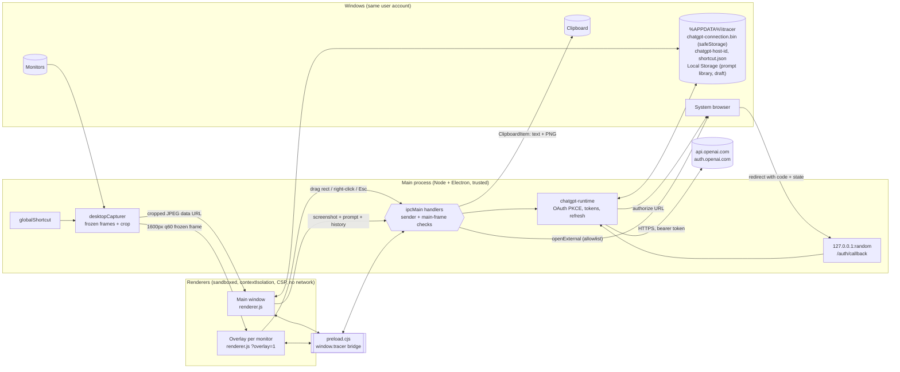

# Tracer architecture

Tracer is an Electron 44 desktop app. A global shortcut freezes every monitor. The user drags a region, or right-clicks to keep the whole monitor, and the main process crops it. The user then sends that picture to ChatGPT (Sign in with ChatGPT plan usage) or copies it for Gemini or Claude.

Written from the code at `c768a2d` plus the uncommitted audit fixes from 25 October 2026.

## Processes and trust boundaries

The boundary that matters is between **Main** and **Renderers**. Everything that touches the operating system, the network, or credentials is on the main side. A renderer can only call the 21 functions in [preload.js](src/preload.js), and each IPC handler in [main.js](src/main.js) checks who is calling: main-window channels require the main window's main frame (`requireSender`), and overlay channels require a live overlay's main frame (`overlayFrom`).

| Data or capability | Main process | Main-window renderer | Overlay renderer | Leaves the machine |
| --- | --- | --- | --- | --- |
| Full-resolution frozen frames | Yes, during selection only | No | No | No |
| 1600px preview of the frozen frame | Yes | No | Its own monitor only | No |
| Cropped screenshot | Yes, transiently | Yes, until Clear / new capture / quit | No | Only after the user submits |
| Prompt text | Yes, per request | Yes, plus Local Storage | No | Only after the user submits |
| ChatGPT access / refresh / ID tokens | Yes | **No** (status, email, name, model name only) | No | Only to OpenAI over HTTPS |
| OS APIs (capture, clipboard, shell, shortcut, files) | Yes | No, only through IPC | No | n/a |
| Local files | Main reads/writes `%APPDATA%\tracer` | No (fuse `GrantFileProtocolExtraPrivileges` off) | No | n/a |
| Network | `fetch` to `auth.openai.com`, `api.openai.com`; loopback listener while signing in | No (`connect-src 'self'`) | No | n/a |

## Main process — [src/main.js](src/main.js)

- **Startup.** Squirrel install events quit early. A single-instance lock keeps one copy; a second launch focuses the first ([main.js:65](src/main.js:65)).
- **Windows.** Every window uses `secureWebPreferences` from [security-policy.mjs](src/security-policy.mjs): `contextIsolation`, `sandbox`, `nodeIntegration: false`, `webSecurity`, no `webview`. `hardenWindow` denies `window.open`, blocks `<webview>`, and blocks navigation or redirects outside the packaged renderer folder (or the dev server in development).
- **Session guards** ([main.js:645](src/main.js:645)). Permission checks allow only `clipboard-sanitized-write` from the main window. Device permissions are refused. `getDisplayMedia` is always refused (`callback(null)`), because capture happens in the main process.
- **Menu.** File → Analyze screenshot (Ctrl+Enter), Clear screenshot, Quit. View → zoom and full screen. DevTools only when a dev server is running.
- **Shortcut.** Stored in `shortcut.json`, validated by `isValidAccelerator`, registered with `globalShortcut`. The Set Hotkey dialog suspends it while the user types a new one. `will-quit` calls `unregisterAll`.

## Screenshot capture

1. `onHotkey` ([main.js:421](src/main.js:421)) enters a capture gate so repeated presses are ignored.
2. `beginRegionSelect` hides the main window, waits 150 ms, then calls `desktopCapturer.getSources` with a thumbnail size equal to the largest monitor in physical pixels (capped at 8192). On the test PC this took about 0.6–1.0 s.
3. Each source is paired to a display by `display_id`, then by physical size ([region-select.mjs:80](src/region-select.mjs:80)). The NativeImages stay in the `frozen` map in main.
4. One frameless, always-on-top overlay window per monitor loads `index.html?overlay=1`. It asks for its own frame (`tracer:frozen-frame`, 1600px JPEG q60) and shows it full-screen.
5. The overlay reports a left-drag rectangle (clamped to its own edges), a right-click, or Escape. Main converts DIP coordinates to thumbnail pixels with `selectionToCrop`, crops, downsizes to at most 1600px, and encodes JPEG q85.
6. Main clears the frozen frames, destroys the overlays, restores its window, and sends `{ type: 'capture', image }` to the main-window renderer. Nothing is written to disk. If the capture started while the window was hidden in the tray and was cancelled, the window stays hidden (`returnToTray`).

## Tray and quitting

- `installTray` creates the tray icon before the window. Clicking it calls `restoreMain`; its menu has Open Tracer and Quit Tracer. If the tray icon cannot be created, closing the window quits as before.
- The window's `close` event hides the window instead, unless `quitting` is set. `before-quit` sets it (Quit Tracer, File → Quit), and so do the window's `query-session-end` and `session-end` events, so Tracer never holds up a Windows sign-out or shutdown. `will-quit` removes the tray icon.
- The first time the window is hidden, `noteRunningInTray` shows a Windows notification with the shortcut and how to quit, and writes `tray-notice.json` so it is not shown again.
- The tray text uses the window's language. The window reports it with `tracer:set-language`, which accepts only listed codes. Before that report, main uses the Windows locale.
- The icon comes from [app-icon.mjs](src/app-icon.mjs), PNGs at 16–64 px that [scripts/build-icons.mjs](scripts/build-icons.mjs) renders from `assets/icon.svg` and `assets/icon-small.svg`. `appIcon` combines them into one image with a representation per display scale, used for the tray and the window.

## ChatGPT sign-in and requests — [src/chatgpt-runtime.mjs](src/chatgpt-runtime.mjs), [src/chatgpt-plan.mjs](src/chatgpt-plan.mjs)

Implements OpenAI's *Sign in with ChatGPT — plan usage for open-source and locally hosted apps* (developers.openai.com/siwc).

- **Sign-in.** Generates a stable `ext_agent_host_id` (`urn:uuid:`), fresh PKCE verifier, `state`, and `nonce`. Starts an HTTP listener on `127.0.0.1` with a random port, then opens the system browser at `https://auth.openai.com/api/accounts/authorize`. First registration uses `client_id=dynamic_agent_client` and `agent_name_hint=Tracer`; later sign-ins reuse the issued `oaiapp_…` id. Scopes: `openid profile email offline_access resource.invoke chatgpt.tokens.use.direct`, resource `https://api.openai.com/v1`.
- **Callback.** Only `GET /auth/callback` with the exact `Host` header and a constant-time `state` match is accepted. The page never echoes the code. The listener closes when sign-in finishes, fails, is cancelled, or times out after 5 minutes.
- **Token exchange.** Form POST to the discovered token endpoint, no client secret. The ID token is verified with `jose` against the discovered JWKS (RS256, issuer, audience, nonce, `azp`). Plan usage is enabled only if the granted `scope` contains `chatgpt.tokens.use.direct`.
- **Storage.** The record (tokens, scopes, expiry, client id, subject, email, name) is JSON encrypted with `safeStorage` and written to `chatgpt-connection.bin`. The renderer only sees `toPublicSession` output.
- **Analyze.** Refreshes when the access token is within 60 s of expiry, lists models (`GET /v1/models`, first `visibility: "list"` entry), then `POST /v1/responses` with `store: false`, `stream: true`, `reasoning: { effort: 'low' }`, `instructions`, and the conversation. The first user turn carries the screenshot as an `input_image` data URL. The SSE stream is read to `response.completed`, capped at 2 MB of stream and 100,000 answer characters, with a 90 s limit.
- **Answer language.** `tracer:ask` passes `language` on only if `isLanguageCode` finds it in the fixed list in [languages.mjs](src/languages.mjs). `buildResponsesBody` then appends "Write the answer in {English name} unless the user asks for another language." to the instructions. Any other value adds nothing, so the window cannot add its own text to the instructions.
- **Lighter reasoning.** If a model answers 400 with an error that names `reasoning` (`rejectedReasoning`), the request is sent once more without it, and that model is remembered in `fullReasoningModels` for the rest of the session.
- **Streaming to the window.** Each `response.output_text.delta` goes to an `onDelta` callback. `createDeltaRelay` in main batches the pieces and sends `{ type: 'answer-delta', requestId, text }` on `tracer-event` at most every 60 ms, then flushes when the request ends. The preload accepts only an integer `requestId` and a string of up to 100,000 characters. The window ignores pieces whose `requestId` is not the current request, and the finished answer from `tracer:ask` replaces the streamed text. In development the main process logs the time to the first text and to the end.
- **401 recovery.** A 401 from `/v1/models` or `/v1/responses` triggers one forced refresh and one retry. If the refreshed token is also rejected, it is revoked and cleared. A temporary refresh failure keeps the credentials.
- **Clearing credentials.** Every path that forgets tokens goes through `clearCredentials`, which revokes the refresh token at the discovered `revocation_endpoint` first. That covers Disconnect, terminal refresh errors, a rejected retry, and an identity mismatch. Disconnect keeps the client id and subject so the same account can sign back in.
- **Use a different ChatGPT account.** `signIn({ fresh: true })` registers with `dynamic_agent_client`, ignores the saved client id and email, and writes nothing until the new ID token verifies. It then revokes the old account's refresh token and replaces the record. The window only learns `savedAccount: true/false`.

## Gemini and Claude handoff

`tracer:handoff` validates the provider with `handoffUrl` (own keys of `HANDOFF_TARGETS` only), validates the prompt and screenshot, writes one `ClipboardItem` with `text/plain` and `image/png`, and opens `https://gemini.google.com/app` or `https://claude.ai/new`. Nothing is submitted and no provider session is read.

## Renderer — [src/renderer.js](src/renderer.js)

- One bundle serves both windows; `?overlay=1` selects overlay mode.
- Layout: a top bar with the language button, Hide prompts, and the account menu, the prompt box with Save Prompt, Set Hotkey, and "Send right after capture", a scrolling area with the screenshot and the conversation, and a bottom bar with status, the follow-up box, and the plan note.
- The workspace keeps `latestScreenshot` and `turns` (the questions and answers for that screenshot) in memory. Each request sends the last 14 turns.
- With "Send right after capture" on (stored in `localStorage['tracer:auto-send']`), a capture event sends the prompt box at once. A capture made while signed out is held, and the account menu opens instead.
- Answers are parsed by [markdown-blocks.mjs](src/markdown-blocks.mjs) into paragraphs (keeping line breaks), headings, bulleted and numbered lists, quotes, dividers, tables, and code blocks, with inline code, bold, and italics. Everything is built with `textContent`. There is no `innerHTML`, and links are shown as text.
- `abandonAction` cancels and ignores an in-flight reply when the screenshot changes or is cleared.
- Set Hotkey records the pressed keys and registers them only on Apply & Save.
- Hide prompts adds `library-hidden` to the app grid, which drops the library column. The choice is stored in `localStorage['tracer:library-hidden']`.

## Languages — [src/languages.mjs](src/languages.mjs), [src/i18n.mjs](src/i18n.mjs)

- `LANGUAGE_CODES` lists 217 codes: ISO 639-1 plus common extras such as Cantonese, Filipino, and both Chinese scripts. Names come from `Intl.DisplayNames`, in English and in the language itself. `matchLanguage` maps the Windows locale to a listed code for the first-launch preselection.
- The window's text uses English as the key. [i18n-messages.mjs](src/i18n-messages.mjs) lists every message, and each file in [src/locales/](src/locales/) maps those messages to one language. `translator(code)` looks up a message with `Object.hasOwn`, fills `{name}` placeholders, and falls back to English. HTML text is marked with `data-i18n`, `data-i18n-label`, `data-i18n-placeholder`, and `data-i18n-alt`. Messages from the main process are English and are translated in the window.
- The chosen code is stored in `localStorage['tracer:language']`. With nothing stored, the window opens the picker first; there it has no Cancel and Escape is blocked. Choosing a language previews it at once; Cancel restores the saved one.
- `<html lang>` follows the choice. `dir="rtl"` is set only for right-to-left languages that have a translation (Arabic and Persian), and the CSS uses logical properties so the layout mirrors. Prompts and answers use `dir="auto"`.
- An untouched default prompt is replaced with the new language's version; a prompt the user typed is kept.

## Prompt library — [src/prompt-library.mjs](src/prompt-library.mjs)

Pure functions over `{ historyEnabled, saved[≤100], past[≤50] }`, persisted to `localStorage['tracer:library']`. Text is limited to 2000 characters and titles to 80. Favorites is a view over both lists, one card per text. The current draft is stored separately in `localStorage['tracer:draft']`.

Other window settings in `localStorage`: `tracer:auto-send`, `tracer:language`, and `tracer:library-hidden`.

## Packaging — [forge.config.mjs](forge.config.mjs)

Electron Forge with the Vite plugin. The asar contains only `.vite/build/{main,preload}.cjs`, the renderer HTML/JS/CSS, and `package.json`. Fuses: `RunAsNode` off, `NODE_OPTIONS` off, inspect flags off, asar integrity on, load only from asar, file-protocol extra privileges off, cookie encryption on. The Squirrel maker builds a per-user installer. `tracer.exe` and `Setup.exe` get `assets/icon.ico` (16–256 px). No auto-update is configured.

## Unused code in the tree

- `backend/` — an Express loopback stub. Not started, not packaged.
- `releaseMediaStream` and `buildInspectResult` in `security-policy.mjs` — left from the earlier media-stream and `tracer:inspect` design. Only tests call them.
- `scripts/verify-region-capture.mjs` and `scripts/verify-handoff-clipboard.mjs` — manual Electron checks, not part of `npm test`.
