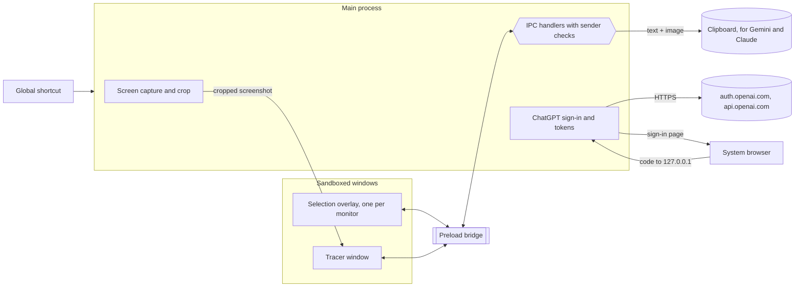

# Tracer

Tracer is a Windows desktop app for asking questions about whatever is on your screen. You press a shortcut, drag over part of the screen, and Tracer sends that picture with your question to ChatGPT using your own ChatGPT plan. The answer appears in the Tracer window, and you can keep asking follow-up questions about the same screenshot.

**Status:** preparing the first public release (1.0.0) for Windows 10 and 11. The Windows installer builds and passes local checks; a clean-PC install test and the GitHub release are still to come. The app is not code-signed yet.

## Download

Get `Tracer-Setup-win32-x64.exe` from the [latest release](https://github.com/enobot/Tracer/releases/latest) once 1.0.0 is published. It installs for your Windows account without administrator rights and needs no other software. Because it is not code-signed yet, Windows may show "Windows protected your PC"; choose **More info**, then **Run anyway**.

- [Install, first run, and troubleshooting](docs/INSTALL.md)
- [Privacy notice](PRIVACY.md)

## Why I built it

I kept switching between apps to translate text or ask about something on my screen: copy it, open a browser tab, paste, wait, switch back. I wanted that to be one shortcut. Part of the idea came from watching my parents deal with English-language content on their screens, where they needed a translation or an explanation of what they were looking at.

Tracer is for people who read on-screen content in a second language, students, and anyone who wants to ask about what they see without leaving the app they are in.

## Features

What the current code does:

- **Screen capture with a global shortcut.** `Ctrl+Shift+Space` by default. Tracer hides its window, freezes every monitor, and shows a selection overlay. Drag to capture an area, right-click to capture the whole monitor, Esc to cancel.
- **Send right after capture.** On by default: when you let go of the selection, the screenshot and the prompt are sent immediately. Turn it off to look at the screenshot first and send it with **Analyze screenshot** or `Ctrl+Enter`.
- **ChatGPT through your own plan.** Sign in with ChatGPT in the browser. Tracer asks for permission to use your plan and never sees your password or an API key.
- **Conversation per screenshot.** Answers appear under the screenshot word by word as ChatGPT writes them, and the box at the bottom sends follow-up questions with the earlier turns. Answers support lists, tables, quotes, and code, and have a Copy button.
- **Language setting.** The first time Tracer opens, it asks which language to use, with the Windows language preselected. The globe button at the top changes it later. The list has 217 languages, each shown in its own script and in English, and is searchable. Answers come back in the chosen language. The buttons and messages are translated into 20 languages besides English; for the others they stay in English. Arabic and Persian lay the window out right to left.
- **Gemini and Claude handoff.** For these, Tracer copies the screenshot and prompt to the clipboard and opens the official website. You paste them yourself; Tracer does not sign in to those services.
- **Prompt library.** Past Prompts (can be turned off and cleared), Favorites, and Saved Prompts that you can edit, rename, and delete. Stored locally. **Hide prompts** at the top hides the whole panel, and Tracer remembers that choice.
- **Custom shortcut.** **Set Hotkey** records a new key combination, and **Apply & Save** registers it. Combinations that would block normal typing, such as `Shift+A`, are refused.
- **Keeps running in the tray.** Closing the window hides Tracer to the system tray by the clock, so the shortcut keeps working. Click the tray icon to open the window, or right-click it and choose **Quit Tracer** to exit. The first time the window is closed, a notice explains this. The tray menu and notice follow the language setting.
- **Icon.** A hand on a mouse with the pointer finger on the left button and the middle finger on the right, for the two clicks Tracer uses: drag to select an area, right-click for the whole screen. A dotted selection frame and scissors cutting along it stand for the screenshot. Black and white with purple buttons. At 16 and 20 px, where the hand is too small to read, the icon shows just the mouse inside the dotted frame.
- **Account controls.** Disconnect revokes Tracer's access at OpenAI. **Use a different ChatGPT account** switches accounts. **Manage usage** opens ChatGPT's usage settings.

Implemented but only partly verified:

- **Multiple monitors and display scaling.** The capture code handles several monitors and different scale factors, and the math is unit-tested. I have only tested it on one 3440×1440 monitor at 100% scaling.
- **Pasting into Gemini and Claude.** The clipboard contents are verified (text plus a PNG). Whether those websites accept both from one paste has not been tested.

## Technologies

| Technology                                        | Why                                                                                                                                  |
| ------------------------------------------------- | ------------------------------------------------------------------------------------------------------------------------------------ |
| Electron 44                                       | I wanted to build a desktop app and learn something new. Electron let me do that with JavaScript. I did not compare frameworks first |
| Electron Forge with Vite                          | The Electron Forge template I started from. It builds the app and makes the Windows installer                                        |
| Plain JavaScript, HTML, CSS                       | The window is built without a UI framework                                                                                           |
| OpenAI Sign in with ChatGPT and the Responses API | Lets people use the ChatGPT plan they already pay for, so Tracer needs no API key or billing of its own                              |
| `jose`                                            | Verifies the signed ID token OpenAI returns at sign-in                                                                               |
| `Intl.DisplayNames`                               | Built into Chromium. Names each language in English and in its own script, so the language list needs no hand-made name table        |
| Node's built-in test runner (`node:test`)         | Runs the automated tests without extra dependencies                                                                                  |
| oxlint and oxfmt                                  | Linting and formatting                                                                                                               |

## Architecture

Electron splits the app into a privileged main process and sandboxed renderer windows. Everything that touches the screen, the clipboard, the network, or credentials runs in the main process. The windows can only call a short list of functions exposed by the preload script.



1. **Capture.** The shortcut makes the main process hide the window and take a full-resolution snapshot of each monitor (`desktopCapturer`). Then it opens one overlay per monitor. The overlay only reports the rectangle you drew; the main process crops the snapshot and sends the result to the Tracer window. The overlay is drawn after the snapshot, so it never appears in the picture.
2. **Ask.** The window sends the screenshot, the question, and earlier turns over IPC. The main process checks the payload, refreshes the access token if needed, and calls `POST https://api.openai.com/v1/responses` with `store: false` and `stream: true`. The request asks for low reasoning effort to answer faster, and falls back to the model's default if a model refuses that setting. The chosen language is added to the instructions as "Write the answer in …". The main process forwards the answer text to the window in batches every 60 ms while it arrives.
3. **Sign-in.** OAuth with PKCE in the system browser. The redirect comes back to a temporary listener on `127.0.0.1` that only accepts a request with the matching `state`. Tokens are encrypted and never sent to the window.

More detail: [ARCHITECTURE.md](ARCHITECTURE.md).

## Project structure

```text
src/
  main.js               Main process: windows, shortcut, capture, IPC, menu
  preload.js            The functions the windows are allowed to call
  renderer.js           Tracer window and the selection overlay
  chatgpt-runtime.mjs   Sign-in, token storage, refresh, requests
  chatgpt-plan.mjs      OAuth and request helpers, error messages, URL allowlist
  security-policy.mjs   Window settings, CSP, input and shortcut checks
  region-select.mjs     Mapping a selection to screenshot pixels
  overlay-gestures.mjs  Drag, right-click, and Esc handling in the overlay
  markdown-blocks.mjs   Turns answers into safe text blocks
  prompt-library.mjs    Past, favorite, and saved prompts
  languages.mjs         The language list, names, right-to-left check, Windows match
  i18n.mjs              Looks up the window's text in the chosen language
  i18n-messages.mjs     Every English message the window can show
  locales/              One file of translations per language
test/                   Automated tests (node:test)
  app-icon.mjs          Tray and window icon images (generated)
assets/                 Icon drawings (SVG) and the packaged .ico and .png
scripts/                Manual checks that run inside Electron, and the icon build
backend/                Unused local test server, not part of the app
```

## Setup

Requirements: Windows 10 or 11, Node.js, npm. The app has only been run on Windows; macOS and Linux build settings exist but have not been tried.

```bash
npm install
```

```bash
npm install --prefix backend
```

The second command is only needed for the tests, because one test file covers the unused `backend/` server.

```bash
npm start
```

`npm start` runs the app in development mode with DevTools open. To build it:

```bash
npm run package
```

`npm run package` puts the app in `out/Tracer-win32-x64/`. `npm run make` also builds the installer, `out/make/squirrel.windows/x64/Tracer-Setup-win32-x64.exe`. Both are unsigned, so Windows SmartScreen will warn on first launch. Publishing a release is described in [docs/RELEASING.md](docs/RELEASING.md).

To change the icon, edit `assets/icon.svg` (24 px and up) or `assets/icon-small.svg` (16 and 20 px), then rebuild the icon files:

```bash
npx electron scripts/build-icons.mjs
```

## How to use

1. On first launch, pick your language and click **Continue**. To change it later, click the globe button at the top.
2. Click the account button at the top right and choose **Continue with ChatGPT**. Sign in in the browser and allow Tracer to use your plan. The button then reads **ChatGPT connected**.
3. Type a prompt at the top, or pick one from the prompt library, for example "Translate all the text in this screenshot into Vietnamese."
4. Press `Ctrl+Shift+Space` and drag over what you want to ask about.
5. Read the answer, then ask follow-up questions in the box at the bottom. Each follow-up sends the screenshot again.
6. **Remove screenshot** clears the screenshot and the conversation.
7. Closing the window keeps Tracer running in the tray, so the shortcut still works. To exit, right-click the Tracer icon by the clock (it may be under the ^ arrow) and choose **Quit Tracer**.

To use Gemini or Claude instead, pick it in the account menu. Submitting copies the screenshot and prompt and opens the website, where you paste them.

ChatGPT usage counts against your plan's limits. OpenAI's documentation describes this for Plus and Pro plans, with a per-app cap you can set under Settings, then Usage. If you allow credits for Tracer there, extra use can spend credits.

## Testing and validation

| Command                                             | What it covers                                                                                                                                                                                                                                                                                                                                                                                                                                                                   |
| --------------------------------------------------- | -------------------------------------------------------------------------------------------------------------------------------------------------------------------------------------------------------------------------------------------------------------------------------------------------------------------------------------------------------------------------------------------------------------------------------------------------------------------------------- |
| `npm test`                                          | 98 automated tests: input and shortcut validation, IPC sender checks, CSP and navigation rules, the tray and quit rules, the icon files, region math, the overlay gestures, answer formatting, the prompt library, the language list and every translation file (including a check that every message the main process can show is translated), and the ChatGPT sign-in, streaming, and request flow against a fake OpenAI server (real signed tokens, a real loopback listener) |
| `npx electron scripts/verify-handoff-clipboard.mjs` | Checks the Electron clipboard calls the Gemini and Claude handoff depends on. It uses a synthetic image and restores your clipboard                                                                                                                                                                                                                                                                                                                                              |
| `npx electron scripts/verify-region-capture.mjs`    | Captures colored test windows on each monitor and checks the cropped pixels. Writes `out/region-verify.json`                                                                                                                                                                                                                                                                                                                                                                     |

Results:

- `npm test` on 26 October 2026 (Windows 10, Node 25.8.0): 98 tests, 98 passed, 0 failed. `npm run lint` passes and also runs on GitHub Actions.
- The packaged app (`out/Tracer-win32-x64/Tracer.exe`) started on its own on 26 October 2026, with no Node.js, wrote only to the profile it was given, and made no network connections while idle.
- The built main process was run in Electron with a fresh profile on 26 October 2026 to check the tray. Closing hid the window and kept the shortcut registered. The notice appeared on the first close only. A capture started from the tray and cancelled with Esc left the window hidden. Opening Tracer again showed the window. Switching to Vietnamese translated the tray menu. Quit Tracer and a simulated Windows sign-out both exited.
- The built window was driven with a stand-in main process and no network on 26 October 2026. The first-launch language picker could not be skipped, choosing Vietnamese translated the window and the default prompt, the request carried the chosen language, streamed text appeared before the answer finished, Arabic switched the layout to right to left, a language without translations kept English buttons, and Hide prompts stayed hidden after a reload.
- The same tests run on GitHub Actions (Windows, Node 24) for every push and pull request to `main`.
- `verify-handoff-clipboard.mjs` passed on 25 October 2026.
- A live ChatGPT run on 26 October 2026 passed. I signed in, allowed plan usage, and analyzed two captures with GPT-6.1-Sol. The answer quoted text that only appeared in the screenshot, and the second answer translated it into Vietnamese. A follow-up question asking for French was answered in French.

The language picker, streamed answers, and Hide prompts were tried in the running app on 26 October 2026; answer timing was not recorded.

Running in the tray after the window is closed was confirmed in the running app on 26 October 2026.

Not yet tested live: how much faster answers arrive, the first-close notice and how the tray icon looks, Disconnect and account switching against the real service, pasting into Gemini and Claude, two or more monitors, and display scaling other than 100%. The automated ChatGPT tests use a fake server, so they show that Tracer follows OpenAI's documented behavior, not that the service behaves as documented. Full details: [TEST_REPORT.md](TEST_REPORT.md).

## Security and privacy

- **Process isolation.** Windows run with `contextIsolation`, `sandbox`, and Node integration off, under a Content Security Policy that only allows the app's own scripts and no network access. Navigation, new windows, and `<webview>` are blocked. Every IPC handler checks which window and frame sent the message.
- **Tokens.** ChatGPT tokens stay in the main process. They are encrypted with Electron `safeStorage`, which on Windows uses DPAPI for your user account. The window only learns the connection status, email, and model name. Tokens are revoked before they are deleted.
- **Permissions.** Screen capture happens in the main process. Pages cannot request a screen recording, the camera, or the microphone, and can only write text to the clipboard. The packaged app disables `RunAsNode` and Node inspect flags, and checks the integrity of its own code archive.
- **Screenshots.** Kept in memory, never written to disk by Tracer. Sent only when you capture with "Send right after capture" on, choose Analyze screenshot, or ask a question, and only to the provider you picked. Answers are displayed as text, so model output cannot run code in the window.
- **Language.** The choice is stored locally. Only the language's English name goes to OpenAI, inside the request instructions. The main process accepts only codes from its fixed list, so the window cannot slip other text into the instructions.

Known limits:

- Other programs running under your Windows account can still decrypt the tokens, as with browser cookies.
- Prompts are stored in plain text.
- After a Gemini or Claude handoff, the screenshot stays on the clipboard.
- Uninstalling leaves `%APPDATA%\tracer`.
- `store: false` asks OpenAI not to keep responses for later retrieval; OpenAI's own retention policies still apply.

Reviews: [SECURITY_AUDIT.md](SECURITY_AUDIT.md) and [PRIVACY_REVIEW.md](PRIVACY_REVIEW.md).

## Technical challenges and lessons learned

- **A platform API changed under me.** The Gemini and Claude handoff used the clipboard API from older Electron examples. In Electron 44 that call fails without throwing, so nothing was copied while Tracer said it was. Only running the real Electron API showed it; my mocked tests passed. Now there is a script that checks the real API.
- **Reading the provider's error contract.** OpenAI documents which refresh errors are final. Before I mapped them, a user returning after the 30-day refresh-token lifetime saw a misleading "screenshot" error on every try. Error handling now follows OpenAI's errors-and-recovery page, with tests.
- **Async races in the UI.** Capturing a new screenshot while an answer was still loading could show the old answer under the new picture. Each request now carries a generation number, and stale replies are dropped.
- **Coordinates are not pixels.** The overlay reports positions in device-independent pixels, while the snapshot is in physical pixels and can be scaled per monitor. The crop is converted using each monitor's snapshot size.
- **Prompt wording matters.** In my first live run I wrote "Let me select the area I want screenshotted and then translate it." The model explained how to do that instead of translating. A direct instruction worked.

## Limitations and future improvements

- Not code-signed and no auto-update yet. Options and costs: [docs/RELEASING.md](docs/RELEASING.md).
- Tracer keeps running after the window is closed until you choose Quit Tracer. It does not start with Windows.
- The 20 translations of the buttons and messages were AI-generated and have not been checked by native speakers yet.
- Tracer asks ChatGPT for low reasoning effort to answer faster, which can make answers to hard questions less thorough. There is no setting for it yet.
- Tracer uses the first model your account lists, with no model picker.
- One ChatGPT account is stored at a time.
- Only tested on Windows with one monitor at 100% scaling.
- Ideas I have not built: reading answers aloud, and other ways to trigger a capture (for example camera or eye-blink input).

## Development transparency

I designed and architected this project, including its concept, features, user experience, and technical direction. I used AI-assisted development tools (Claude, ChatGPT, and Cursor) to support parts of the implementation, debugging, testing, security review, and documentation. I reviewed and evaluated the generated suggestions, and I remain responsible for the project's design decisions, functionality, and known limitations.

## Author

Tracy Tran, computer science student at California State University, Fullerton, graduating May 2027. [tracythutran.com](https://www.tracythutran.com)

## License

MIT. See [LICENSE](LICENSE) and, for bundled packages, [THIRD_PARTY_NOTICES.md](THIRD_PARTY_NOTICES.md). Tracer is not affiliated with or endorsed by OpenAI, Google, or Anthropic.
